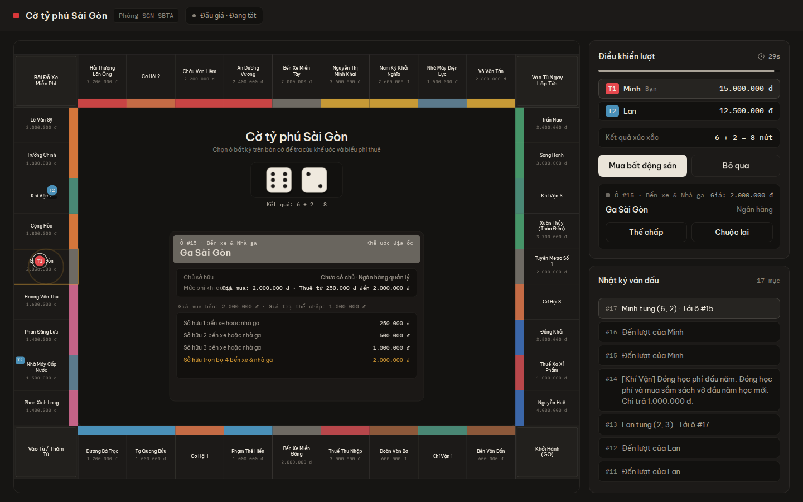
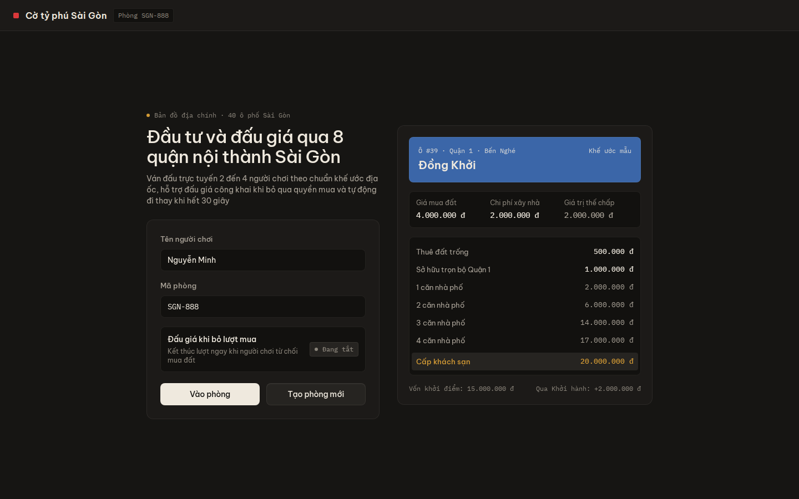
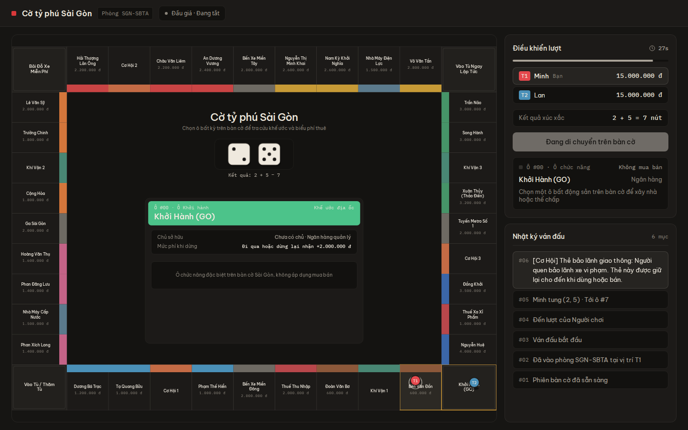
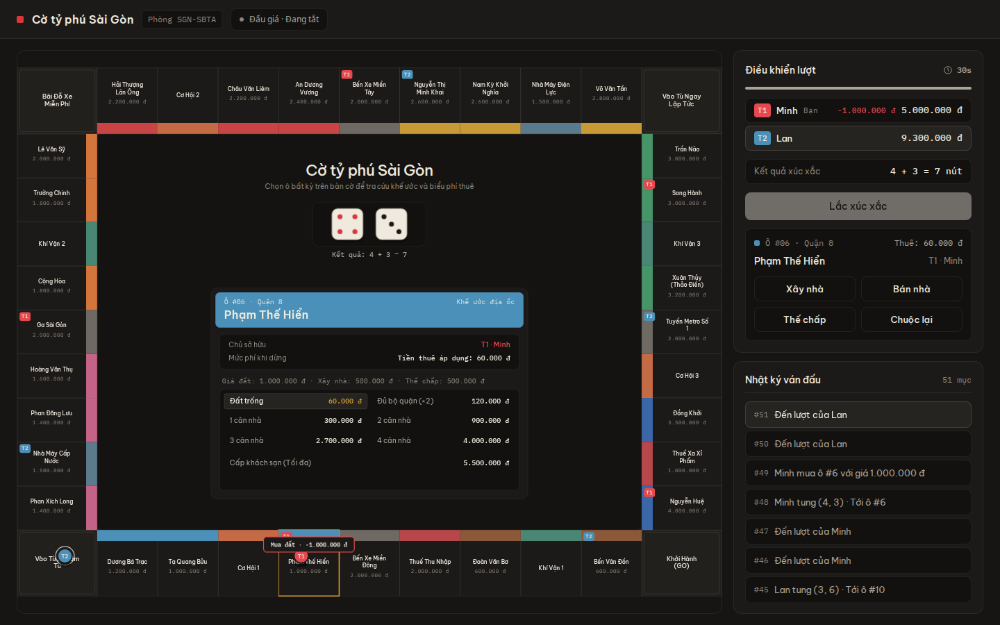
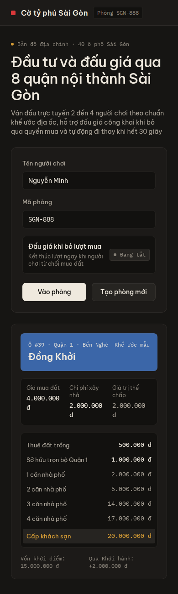
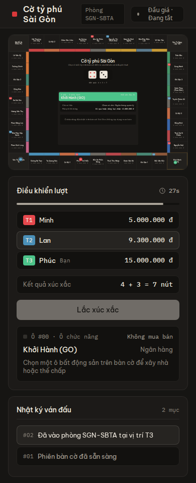

# Cờ Tỷ Phú Sài Gòn: đánh giá UI & hiệu năng

> Review · `monopoly-mayhem` @ `ccdc6b2` · 13/11/2026

Tôi đã build và chạy thật: server Axum (bản release) và client Leptos/WASM. Cho 2–3 người chơi điều khiển bằng Chrome headless chơi 12 lượt, rồi đo FPS, layout và heap qua Chrome DevTools Protocol.

Nền tảng kỹ thuật tốt và giao diện có gu. Tuy vậy server có một lỗi làm treo phòng (đã tái hiện được), cần sửa trước khi cho ai chơi thật.

---

## 1. Điểm số

### UI / UX: **5.5 / 10**

| Hạng mục | Điểm |
|---|---|
| Thẩm mỹ, bảng màu, typography | 8 |
| Độ dễ đọc bàn cờ | 4 |
| Game feel / phản hồi | 6 |
| Luồng chơi đầy đủ | 4 |
| Mobile | 3 |
| Accessibility | 2 |

### Performance: **5 / 10**

| Hạng mục | Điểm |
|---|---|
| Client runtime (FPS, heap) | 8 |
| Hiệu quả render (layout) | 5.5 |
| Tải trang / bundle | 6 |
| Server: ổn định & throughput | 2 |

Riêng client thì khoảng **7.5/10**. Điểm tổng bị kéo xuống vì lỗi treo phòng ở server.

---

## 2. Giao diện thực tế

Chụp từ build release, viewport 1440×900 (desktop) và 390×844 (mobile).

### Màn chơi: đang quyết định mua đất

Ở thẻ khế ước giữa bàn, dòng “Mức phí khi dừng” bị chữ “Giá mua: …” đè lên.

### Sảnh chờ

Bố cục 2 cột gọn đẹp. Thẻ mẫu ghi “Ô #39 · Đồng Khởi · 4.000.000 đ”, nhưng dữ liệu thật là **ô #37, giá 3.500.000 đ**. Ô #39 là Nguyễn Huệ.

### Quân cờ đang di chuyển

Log đã hiện nội dung thẻ Cơ Hội trước khi quân tới ô. Dòng “Đến lượt của **Người chơi**” bị thiếu tên.

### Sau 12 lượt

Mỗi dòng “Đến lượt của …” xuất hiện 2 lần. Nút “Lắc xúc xắc” bị xám khi chưa tới lượt mình, không ghi đang chờ ai.

### Tra cứu ô

Bảng giá thuê rõ ràng. Tên ô trên bàn chỉ khoảng 7px, giá tiền tương phản thấp.

### Mobile
| Sảnh | Màn chơi |
|---|---|
|  |  |
| Xếp 1 cột ổn. | Bàn cờ không đọc được. Người thứ 3 vào giữa ván đang chơi. |

---

## 3. Số đo hiệu năng

Client: 12 lượt chơi liên tục (~30 giây), Chrome headless, đo trên tab người chơi A.

| Chỉ số | Giá trị |
|---|---|
| FPS trung bình | **59.1** |
| Frame p50 / p95 / p99 / max | 16.7 / 16.8 / 33.3 / 66.6 ms |
| Frame > 33 ms | 21 / 1775 |
| Long task > 50 ms | **0** |
| JS heap | 2.8 MB |
| Phần tử DOM | 532 |
| Tổng thời gian **Layout** | **7.15 s** (~2.000 lần layout) |
| Tổng thời gian Script | 0.38 s |
| Tổng thời gian Recalc Style | 0.29 s |
| WASM gửi đi | **733 KB chưa nén** (gzip: 218 KB) |
| RSS server lúc rảnh | ~8 MB |
| Log server sau ~3 phút bị treo | **6.4 GB** |

Code WASM chạy rất nhẹ (0.38s script). Thời gian chủ yếu tốn ở **layout**, do mỗi snapshot và mỗi bước nhảy lại dựng lại node DOM/SVG thay vì chỉ cập nhật thuộc tính.

---

## 4. Phát hiện chi tiết

### P0: Phòng treo vĩnh viễn khi người đang tới lượt đóng tab ✅ đã tái hiện
`crates/monopoly-server/src/router.rs:166-180` · `room.rs:263-276`, `room.rs:362-370`

- Router gửi `DisconnectClient` **2 lần**: một lần ở cuối `recv_task`, một lần sau `select!`.
- `handle_disconnect` ghi đè `grace_timer_handle` mà **không abort** timer cũ, nên 2 timer 15 giây cùng bắn.
- Timer thứ nhất: bot chơi xong lượt rồi chuyển lượt. Timer thứ hai: bot được gọi cho người **không còn tới lượt**, `RollDice` bị từ chối với `NotCurrentPlayer`, state không đổi.
- Vòng `while let Some(..) = XeOmBot::decide_action(..)` trong `execute_bot_sequence` lặp mãi.
- Kết quả: actor phòng chết, 1 core CPU chạy liên tục, log tăng khoảng **35 MB/giây**. Phòng cũng không bao giờ được dọn, vì `EmptyRoomTimeout` không còn được xử lý. Xảy ra ở cả 2 phòng test.

### P0: Bot đấu giá tự trả giá đè chính mình, rồi `PassAuction` lặp vô hạn
`crates/monopoly-server/src/bot.rs:52-68` · `crates/monopoly-core/src/rules.rs:340-438`

- Khi hết giờ trong phiên đấu giá, bot tăng giá thêm 50k **trên giá của chính nó** cho tới nửa giá đất.
- Sau đó `PassAuction` trả `Ok` mà state không đổi (vẫn còn ≥2 người đấu giá), nên lại vào vòng lặp vô hạn.
- `PlaceBid`/`PassAuction` không kiểm tra người gọi có thuộc `active_bidders` hay không. Người đã bỏ đấu giá vẫn trả giá lại được.
- Phiên đấu giá không có timeout. Người không bấm gì sẽ làm cả bàn chờ mãi.

### P0: Ai cũng đổi được luật phòng, ở bất kỳ lúc nào
`crates/monopoly-core/src/rules.rs:89` · `crates/monopoly-client/src/ws.rs:53-56`

`ConfigureGame` bỏ qua kiểm tra người chơi và giai đoạn. Client gửi nó ngay khi kết nối, nên **mỗi người vào sau sẽ ghi đè** cấu hình đấu giá của chủ phòng.

### P1: Không có phòng chờ, ván bắt đầu ngay khi có 1 người
`crates/monopoly-server/src/room.rs:187-202`

- Người thứ 2 trở đi vào **giữa ván đang chạy**. `GameStarted` được broadcast lại khi đủ 4 người.
- Chưa có nút “Sẵn sàng/Bắt đầu”.
- Chưa có màn kết thúc ván: client không xử lý `is_game_over`/`winner`.
- Chưa có giao dịch giữa người chơi.

### P1: Hướng dẫn chạy trong README không chạy được
`README.md` · `crates/monopoly-client/Trunk.toml` · `crates/monopoly-client/src/app.rs:124-127`

- `trunk serve` và server **cùng dùng cổng 8080**, và client mở WebSocket tới `location.host`, tức cổng của trunk.
- Hook của Trunk gọi `python`, trong khi Ubuntu chỉ có `python3`.

### P1: Animation quân cờ bị “teleport”
`crates/monopoly-client/src/components/board.rs:851-940`

Toàn bộ nhóm pawn nằm trong một closure `move ||`, nên mỗi bước nhảy **tạo node mới**. CSS `transition: transform 115ms` vì thế không bao giờ chạy, chỉ còn hiệu ứng hop. Nên dùng `<For each=.. key=seat>` và chỉ cập nhật `style`.

### P1: Một client chậm làm nghẽn cả phòng; serialize 2 lần
`crates/monopoly-server/src/room.rs:373-377` · `router.rs:150-158`

- `broadcast` gọi `await` lần lượt trên channel có giới hạn 64 của từng client, nên **một socket chậm chặn cả actor**.
- Mỗi action tạo `SyncSnapshot` toàn bộ qua `serde_json::to_value`, rồi lại `to_string` riêng cho **từng client**.
- Hướng sửa: dùng `try_send` (hoặc ngắt client chậm), serialize một lần thành `Arc<str>`, và gửi delta thay cho snapshot đầy đủ.

### P2: Render lãng phí ở client
- Khoảng 6 closure cho mỗi ô × 40 ô đều gọi `state.get()`, tức clone cả `GameState`. Mỗi snapshot tốn khoảng **240 lần clone**.
- `get_board()` dựng lại mảng 40 ô kèm `String` ở mỗi lần gọi, kể cả trong từng bước animation.
- Hướng sửa: dùng `state.with(..)`, `create_memo` cho từng ô, và `static BOARD: LazyLock<[Tile; 40]>`.

### P2: Lỗi hiển thị nhỏ
- Chữ đè nhau ở thẻ khế ước của Ga/Bến xe.
- Log “Đến lượt” lặp 2 lần, vì cả `advance_turn` và `start_player_turn` đều phát `TurnStarted`.
- Log ghi “ô #15” thay vì tên đường.
- Log tiết lộ thẻ Cơ Hội/Khí Vận trước khi quân tới ô.
- Thẻ mẫu ở sảnh sai dữ liệu (Đồng Khởi).
- `favicon.ico` 404.
- Nút bị xám thay vì ghi “Đang chờ Lan…”.

### P2: Accessibility và mobile
- Toàn bộ client không có `aria-*`/`role` nào.
- Không tôn trọng `prefers-reduced-motion`.
- Công tắc đấu giá là `div` có `on:click`, không dùng được bằng bàn phím.
- `user-select: none` áp cho toàn trang.
- Tên ô dùng `font-size` 8.5–9.5 trên viewBox 1280, tức khoảng **7px trên desktop, khoảng 2px trên điện thoại**.
- Bàn cờ tỉ lệ 4:3, không vuông.

---

## 5. Điểm mạnh nên giữ

- **Kiến trúc tách lớp rõ**: `monopoly-core` thuần, deterministic, dùng chung cho cả native và WASM.
- Server authoritative theo mô hình **actor mỗi phòng**.
- Bảng màu tối ấm được định nghĩa bằng token, typography Be Vietnam Pro hợp với tiếng Việt.
- Nội dung bản địa hóa có tâm: quận, đường, thẻ Khí Vận / Cơ Hội.
- Có chuỗi animation xúc xắc → nhảy từng ô → popup tiền.
- Có reconnect bằng session token và bot “Xe Ôm” đi thay khi hết giờ.
- Tất cả **16 test đều qua** (10 core, 5 server, 1 client).

---

## 6. Nên phát triển gì tiếp (theo thứ tự)

1. **Vá các lỗi P0 ở server**
   - Bỏ lần gửi `DisconnectClient` thứ hai, abort timer cũ trước khi ghi đè.
   - Trong `execute_bot_sequence`: dừng khi action bị từ chối hoặc state không đổi, giới hạn số bước, và kiểm tra bot đúng là người đang tới lượt.
   - Kiểm tra `active_bidders`, thêm timeout cho đấu giá.
   - Chỉ chủ phòng được `ConfigureGame`, và chỉ trước khi bắt đầu.
   - Thêm test tích hợp cho từng tình huống này.
2. **Hoàn thiện luồng ván chơi**: phòng chờ với nút sẵn sàng và nút bắt đầu cho chủ phòng, màn thắng/thua, UI đấu giá (đếm giờ, người đang trả giá cao nhất), giao dịch đất giữa người chơi. Thiếu giao dịch thì cờ tỷ phú mất nửa chiều sâu chiến thuật.
3. **Dễ đọc và mobile**: làm bàn cờ vuông, tên ô ít nhất 12px khi hiển thị. Trên điện thoại cho phép zoom/pan bàn cờ, hoặc chỉ hiện dải ô quanh quân đang đi kèm minimap. Thanh hành động dính đáy màn hình. Viết rõ “Đang chờ Lan” thay vì nút xám.
4. **Hiệu năng render**: dùng `<For>` có key cho pawn và ô, memo theo từng ô, board tĩnh. Gửi delta thay cho snapshot. Bật `CompressionLayer` (br/gzip) và `wasm-opt -Oz`, tự host font.
5. **Vận hành**: rate-limit theo socket, giới hạn số phòng, đặt log của action bị từ chối ở mức `debug` hoặc lấy mẫu, viết Dockerfile, sửa README, thêm metric (số phòng, độ trễ action).
6. **Chiều sâu và giữ chân người chơi**: bot AI để chơi solo/offline, âm thanh, lịch sử ván, link mời vào phòng, rule tùy chọn (Free Parking, vốn khởi điểm).

---

## 7. Cách chạy đúng

```bash
# Yêu cầu: Rust + target wasm32-unknown-unknown + trunk
# Trên Ubuntu cần lệnh `python` (apt install python-is-python3)
cd crates/monopoly-client && trunk build --release   # ra dist/
cd ../.. && cargo run --release -p monopoly-server     # chạy từ thư mục gốc repo
# Mở http://localhost:8080 — server tự phục vụ dist/ và /ws trên cùng cổng
```
