# Cờ Tỷ Phú Sài Gòn: đề xuất UI mới

> Bản trình bày ý tưởng, chưa sửa code game. Ảnh trong `img/` được chụp từ mockup HTML tĩnh trong `mockups/`. Mở file `.html` bằng trình duyệt để xem; thêm `#clean` vào URL để ẩn các huy hiệu số.

---

## 1. Vì sao UI hiện tại trông đơn giản

UI hiện tại không xấu, nhưng nó trông giống **dashboard của phần mềm** hơn là **trò chơi**. Có 7 nguyên nhân cụ thể:

| # | Nguyên nhân | Biểu hiện trên màn hình hiện tại |
|---|---|---|
| 1 | Bảng màu kiểu SaaS | Gần như đen hoàn toàn, chữ xám, nút trắng phẳng. Màu chỉ xuất hiện ở dải 6px trên mỗi ô. |
| 2 | Không có chất liệu | Ô cờ là hình chữ nhật phẳng cùng màu. Không có bóng, độ dày hay họa tiết, nên mắt không cảm thấy có một "bàn cờ" thật. |
| 3 | Giữa bàn bỏ trống | Khoảng 60% diện tích bàn chỉ có tiêu đề, xúc xắc nhỏ và một thẻ khế ước. Đây là chỗ đáng giá nhất màn hình nhưng lại đang bị lãng phí. |
| 4 | Không có nhân vật | Quân cờ là chấm tròn "T1/T2", người chơi chỉ là dòng chữ. Người chơi không có gì để gắn bó. |
| 5 | Chỉ có chữ, không có hình | Ga, bến xe, điện, nước, Cơ Hội, Khí Vận đều chỉ là chữ. Bản sắc Sài Gòn mới nằm ở tên đường, chưa có trong hình ảnh. |
| 6 | Hành động nằm xa nơi mắt nhìn | Quân chạy trên bàn, nhưng nút "Mua" lại ở cột phải, cách đó khoảng 600px. Mắt phải nhảy qua lại liên tục. |
| 7 | Phản hồi yếu | Không có âm thanh. Tiền thay đổi chỉ hiện qua chữ nhỏ. Không có khoảnh khắc nào được làm cho đáng nhớ (mua đất, độc quyền, phá sản). |

Bản thiết kế gốc trong `concepts_brief.md` đã định có minh họa vector vẽ bằng Inkscape, camera bám theo quân trên mobile và minimap. Script `sanitize_svg.py` cũng đã sẵn, nhưng **chưa có file minh họa nào được đưa vào**. Vì vậy phần "đơn giản" chủ yếu là do **thiếu art direction và asset**, không phải do kỹ thuật.

---

## 2. Hướng visual: "Gạch bông & Bảng hiệu"

Hướng này lấy chất liệu từ những thứ chỉ Sài Gòn mới có, thay vì một theme tối chung chung:

| Chất liệu Sài Gòn | Dùng vào đâu trong game |
|---|---|
| **Gạch bông** (gạch hoa xi măng nhà phố cũ) | Họa tiết khăn trải bàn và nền giữa bàn cờ |
| **Tường vàng thuộc địa, cửa lá sách xanh** | Màu chủ đạo: vàng hoàng thổ `#e3a72f`, xanh cửa lá sách `#1f6d5f` làm nền bàn |
| **Bảng hiệu sơn tay** | Dải màu quận trên mỗi ô thành "biển hiệu" có viền chỉ trắng. Tên đường dùng font condensed như biển tiệm. |
| **Vé số kiến thiết** | Thẻ Cơ Hội được thiết kế thành tờ vé số có cuống xé, có dãy số |
| **Phong bì lì xì đỏ** | Biểu tượng ô Khí Vận |
| **Sông Sài Gòn** | Đường sông uốn qua giữa bàn cờ |
| **Xe máy Cub, xích lô, Vespa, xe buýt** | Quân cờ của 4 người chơi, thay cho T1–T4 |
| **Cà phê bệt** | Ô góc Free Parking |

**Bảng màu:** nền bàn xanh lá sách đậm, mặt cờ ngà như vữa tường, chữ màu mực nâu đen. Đỏ son dành cho hành động chính, vàng hoàng thổ cho hành động phụ và điểm nhấn. 8 màu quận được giữ nhưng tăng độ bão hòa để đọc rõ trên nền sáng.

**Typography** (đã chỉnh ở bản v2, xem mục 3):
- **Baloo 2**: chỉ dùng cho chữ lớn từ 18px trở lên, gồm tên ô trên thẻ, số tiền chính và nút.
- **Be Vietnam Pro**: mọi chữ còn lại, kể cả tên đường trên bàn cờ.
- Bản đầu có dùng Barlow Condensed cho tên đường; bản v2 đã bỏ.

**Chiều sâu:** bàn cờ nghiêng nhẹ 18° bằng CSS 3D, có viền dày và đổ bóng xuống khăn trải bàn. Nút có "gờ" dưới đáy để trông bấm được. Cách này đủ cảm giác 2.5D mà **không cần WebGL**, nên vẫn giữ được mục tiêu bundle dưới 500 KB trong design doc.

---

## 3. Bản v2: bớt chữ, dễ nhìn hơn

Bản đầu có quá nhiều chữ nằm sát nhau trong các thẻ tương tác. Bản v2 áp dụng 6 quy tắc sau cho mọi thẻ:

| Quy tắc | Cách áp dụng |
|---|---|
| **Mỗi thẻ trả lời đúng một câu hỏi** | Thẻ mua đất chỉ trả lời "có nên mua không?": tên, giá, một lý do, hai nút. |
| **Ẩn bớt, mở khi cần** (progressive disclosure) | Bảng 6 mức tiền thuê, lịch sử đấu giá, log đầy đủ được chuyển vào link "Xem bảng tiền thuê" / "Xem toàn bộ". |
| **Con số to, nhãn nhỏ** | Thông tin cần quyết định (giá, tiền thắng) ở cỡ lớn nhất. Nhãn ở cỡ 12px màu nhạt. Không để hai thứ cùng cỡ tranh nhau. |
| **Chỉ 4 cỡ chữ** | 12 (nhãn) · 14 (nội dung) · 17 (tiêu đề mục) · 30 (con số / tên chính). |
| **Thay câu bằng hình** | Người tham gia đấu giá hiện bằng avatar (bị mờ khi đã bỏ) thay cho danh sách chữ. Tiến độ quận hiện bằng các vạch thay cho "3/3 · 3 nhà · thuê 300–400k". |
| **Mỗi dòng một ý** | Bản tin và danh sách lựa chọn chỉ một dòng mỗi mục, số tiền tách sang cột phải và căn số đều. |

**Chỉnh font:**
- **Bỏ Barlow Condensed.** Font hẹp làm dấu tiếng Việt (ấ, ể, ỗ) bị chen chúc ở cỡ 11–13px, nhất là khi viết hoa.
- **Bỏ chữ VIẾT HOA giãn cách** ở các nhãn nhỏ. Chữ hoa có dấu chồng tầng khó đọc; nhãn chuyển về viết thường.
- **Be Vietnam Pro** được dùng cho toàn bộ chữ nội dung và tên đường. Đây là font do nhà thiết kế Việt làm riêng cho tiếng Việt, dấu đặt chuẩn và có số đều cột cho tiền.
- **Baloo 2** chỉ còn ở chữ lớn (tên ô trên thẻ, số tiền chính, nút), nơi nét tròn tạo cảm giác "game" mà không bị nhòe.
- Ô đặc biệt dùng tên ngắn quen thuộc (BX Miền Đông, Thuế xa xỉ) để không bị xuống 3 dòng.

**Trước / sau:**

| Bản đầu | Bản v2 |
|---|---|
| 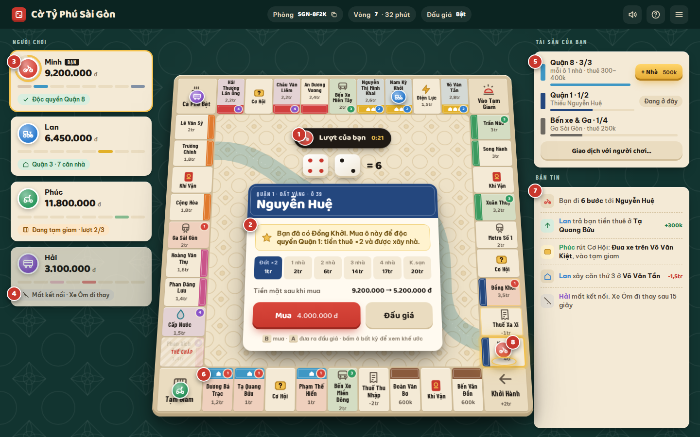 | 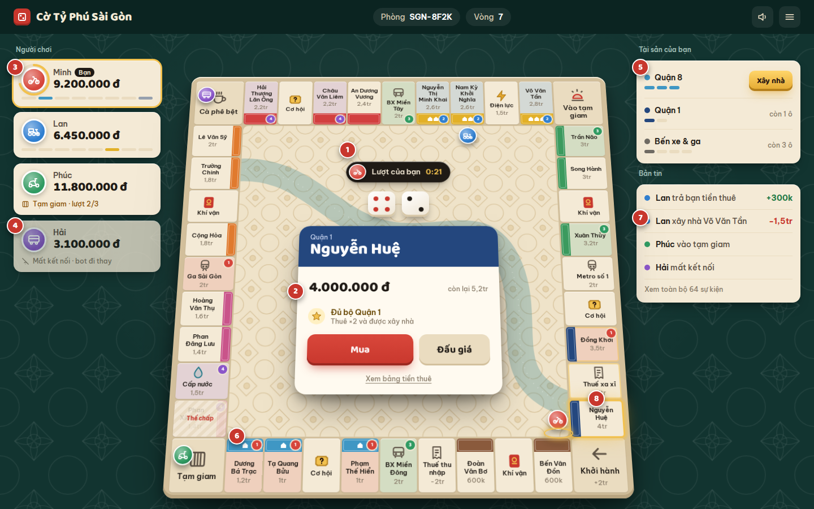 |
| 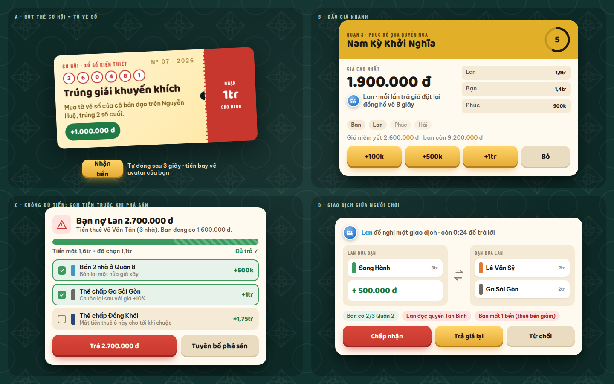 | 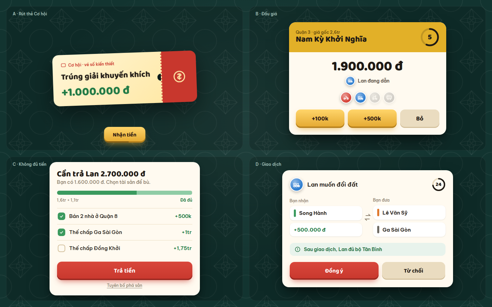 |

---

## 4. Màn chơi desktop

Các số trên ảnh:

1. **Giữa bàn là sân khấu.** Thanh "Lượt của bạn · 0:21", xúc xắc và thẻ quyết định nằm giữa bàn, ngay nơi quân vừa chạy tới. Hai cột bên chỉ để tra cứu.
2. **Thẻ mua đất chỉ còn 4 phần:** tên ô, giá (kèm "còn lại 5,2tr" ở cỡ nhỏ), một lý do ("Đủ bộ Quận 1 · thuê ×2 và được xây nhà"), và 2 nút. Bảng tiền thuê đầy đủ nằm sau link.
3. **Vòng đếm giờ bao quanh avatar** người đang đi, thay cho thanh mảnh 4px.
4. **Thẻ người chơi chỉ có tên và tiền.** Dòng thứ ba chỉ xuất hiện khi có trạng thái đặc biệt ("Tạm giam · lượt 2/3", "Mất kết nối · bot đi thay"). Dải vạch màu cho biết đang giữ đất ở quận nào.
5. **Tài sản mỗi quận một dòng:** tên quận, vạch tiến độ, và một hành động hoặc gợi ý ("Xây nhà", "còn 1 ô").
6. **Ô được tô màu chủ sở hữu** kèm huy hiệu số người chơi. Nhà dựng ngay trên biển hiệu quận. Ô thế chấp có sọc chéo.
7. **Bản tin mỗi dòng một sự kiện:** chấm màu người chơi, câu ngắn, số tiền ở cột phải. Chỉ hiện 4 dòng mới nhất.
8. **Ô vừa đáp xuống phát sáng vàng**, các ô vừa đi qua có viền mờ. Quân cờ đứng ở mép trong của ô (phía giữa bàn) để không che tên đường.

Thanh trên cùng chỉ giữ mã phòng và số vòng. Các thiết lập như đấu giá chuyển vào menu.

---

## 5. Màn chơi mobile (390×844)

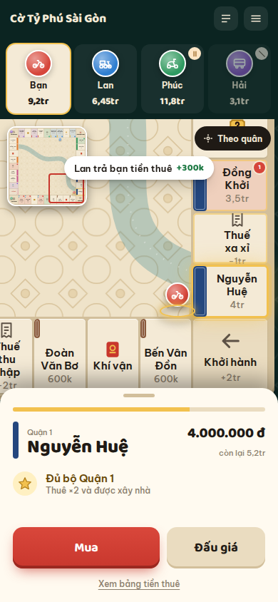

- **Dải người chơi ở trên:** 4 avatar xe, tiền viết gọn (9,2tr). Người đang đi có viền vàng. Có huy hiệu nhỏ cho trạng thái tạm giam hoặc mất kết nối.
- **Camera bám theo quân:** bàn cờ phóng to khoảng 1.2 lần quanh quân đang đi, nên tên đường đọc được ở 15px (hiện tại chỉ khoảng 2px). Đây là quyết định đã có sẵn trong design doc nhưng chưa được làm.
- **Minimap** ở góc có khung đỏ cho vùng đang xem. Chạm vào để nhảy tới vùng khác; nút "Theo quân" để quay lại.
- **Bottom sheet cho quyết định:** giống thẻ desktop, chỉ có tên, giá, một lý do và 2 nút cao 58px trong vùng ngón cái. Thanh thời gian ở mép sheet. Kéo sheet xuống để xem bàn cờ.
- **Toast sự kiện** một dòng nổi trên bàn ("Lan trả bạn tiền thuê +300k") thay cho log dài.

---

## 6. Các khoảnh khắc chính

**A. Thẻ Cơ hội là tờ vé số.** Chỉ có 3 thứ: loại thẻ, tiêu đề, và số tiền thật to. Thẻ lật ra giữa bàn kèm âm thanh, tiền bay về avatar người nhận. Nút "Nhận tiền" có vạch đếm ngược ở đáy và tự bấm sau 3 giây. Câu chuyện vui của thẻ (cô bán vé số trên Nguyễn Huệ…) chỉ hiện trong bản tin, không chen vào thẻ. Khí vận dùng hình phong bì lì xì theo cùng tinh thần.

**B. Đấu giá.** Hiện game chưa có UI đấu giá. Đề xuất:
- Giá cao nhất nằm giữa, cỡ lớn nhất. Ngay dưới là "Lan đang dẫn".
- Người tham gia là một hàng avatar; ai bỏ thì avatar bị mờ.
- Chỉ 3 nút: `+100k`, `+500k`, `Bỏ`.
- Đồng hồ 8 giây, **mỗi lần có người trả giá thì đặt lại về 8 giây**.

**C. Không đủ tiền thì gom tiền trước khi phá sản.** Hiện tại thiếu tiền là phá sản ngay. Đề xuất một màn riêng:
- Một câu nêu rõ cần trả ai bao nhiêu.
- Một thanh đo tiến tới số tiền cần trả.
- Danh sách tài sản, mỗi dòng một lựa chọn kèm số tiền thu được. Nút "Trả tiền" chỉ sáng khi đã đủ.
- "Tuyên bố phá sản" là link nhỏ, tránh bấm nhầm.

Màn này biến khoảnh khắc thua thành một quyết định chiến thuật, thay vì một thông báo cụt.

**D. Giao dịch giữa người chơi.** Đây là phần quan trọng nhất còn thiếu, vì cờ tỷ phú sống nhờ giao dịch. Màn giao dịch gồm:
- Hai cột "Bạn nhận / Bạn đưa" với thẻ đất và tiền.
- **Một dòng hệ quả quan trọng nhất** ("Sau giao dịch, Lan đủ bộ Tân Bình") thay cho nhiều chip.
- Hai nút: Đồng ý, Từ chối. Muốn trả giá lại thì mở một đề nghị mới từ màn giao dịch.
- Vòng đếm giờ ở góc.

---

## 7. Nguyên tắc UX áp dụng cho toàn game

1. **Mỗi lúc chỉ có một hành động chính, nằm ở nơi mắt đang nhìn.** Nút chính màu đỏ son và to. Các lựa chọn khác dùng nút phụ.
2. **Không bao giờ để người chơi phải đoán.** Khi không phải lượt mình, ghi rõ "Đang chờ Lan… (0:18)" thay cho một nút xám. Ghi rõ vì sao không bấm được, ví dụ "Cần độc quyền Quận 1 để xây".
3. **Cho thấy hệ quả trước khi quyết định:** tiền còn lại sau khi mua, hoàn thành bộ quận, tiền thuê sẽ phải trả. Khi rê chuột qua ô của người khác, hiện "Nếu dừng ở đây: trả Lan 900k".
4. **Phản hồi gắn với không gian.** Tiền bay từ avatar người trả sang avatar người nhận. Popup tiền nổi lên ngay trên ô. Con số trong thẻ người chơi chạy lên hoặc xuống thay vì đổi ngay lập tức.
5. **Theo nhịp kể chuyện.** Log và trạng thái chỉ cập nhật **sau khi** quân tới ô, để không lộ trước nội dung thẻ như hiện nay. Thứ tự một lượt: lắc (0.5s) → chạy (khoảng 110ms mỗi ô) → đáp xuống (ô sáng lên) → sự kiện (thẻ hoặc tiền) → quyết định.
6. **Đánh dấu cột mốc.** Khi độc quyền một quận: cả dải quận sáng lên, có âm thanh và toast "Lan độc quyền Quận 3!". Khi lên khách sạn và khi phá sản cũng có khoảnh khắc riêng. Đây là những lúc người chơi nhớ và kể lại.
7. **Không dựa hoàn toàn vào màu.** Mỗi người chơi có màu và hình xe riêng. Trạng thái luôn có chữ đi kèm. Hỗ trợ `prefers-reduced-motion`, chơi được bằng bàn phím, nút cao ít nhất 44px.
8. **Ít chữ trên mọi thẻ:** mỗi thẻ một câu hỏi, tối đa 4 khối nội dung, chi tiết để sau link (xem mục 3).
9. **Âm thanh** (mặc định bật nhỏ, có nút tắt): xúc xắc lăn, bước nhảy "tách tách", tiếng tiền, tiếng búa đấu giá, tiếng còi khi vào tạm giam, tiếng đếm ngược khi còn 5 giây.

---

## 8. Các màn chưa vẽ (mô tả)

- **Phòng chờ:** 4 ghế, người chơi chọn xe và màu. Mỗi người có nút "Sẵn sàng", chủ phòng có nút "Bắt đầu". Có link mời kèm mã QR. Luật phòng (đấu giá, vốn khởi điểm, thời gian lượt) chỉ chủ phòng chỉnh được. Màn này cũng sửa luôn lỗi "ván bắt đầu khi mới có 1 người".
- **Kết thúc ván:** bục vinh quang 1-2-3, biểu đồ tài sản theo từng vòng, các danh hiệu vui ("Vua thu tiền thuê", "Hay vào tạm giam nhất"), nút "Chơi lại cùng nhóm".
- **Hướng dẫn lượt đầu:** 3–4 gợi ý chỉ vào xúc xắc, thẻ khế ước và danh mục tài sản. Bỏ qua được.

---

## 9. Chi phí và cách làm (khi bắt đầu code)

| Hạng mục | Cách làm | Độ khó |
|---|---|---|
| Bảng màu, font, nút, thẻ | Viết lại `palette.rs` và CSS. Leptos/SVG giữ nguyên. | Thấp |
| Bàn cờ 2.5D, ô dạng biển hiệu, tô màu chủ | CSS 3D tilt và sửa component `board.rs` | Trung bình |
| Bộ icon và 4 xe | Khoảng 15 icon SVG, có thể vẽ tay. Đã có đường sanitize asset. | Thấp – trung bình |
| Giữa bàn thành sân khấu | Chuyển thẻ khế ước và nút hành động từ `controls.rs` vào board | Trung bình |
| Camera mobile và minimap | Transform theo vị trí quân, viewport riêng | Trung bình |
| Đấu giá, giao dịch, thiếu tiền | Cần **thêm logic ở server/core**, không chỉ UI | Cao |
| Âm thanh | Web Audio, khoảng 10 file ngắn, tổng dưới 150 KB | Thấp |

**Thứ tự đề xuất:**
1. Bảng màu, font và bàn cờ mới. Thay đổi lớn nhất so với công sức bỏ ra.
2. Giữa bàn thành sân khấu, cộng thêm thông tin hệ quả trước khi quyết định.
3. Mobile với camera bám quân.
4. Phòng chờ và màn kết thúc ván.
5. Đấu giá, thiếu tiền, giao dịch, đi kèm phần sửa server.
6. Âm thanh và các khoảnh khắc ăn mừng.

---

## 10. Cần bạn quyết định

1. ~~Hướng visual~~: đã chốt "Gạch bông & Bảng hiệu" và bảng màu hiện tại.
2. **Mức độ 3D:** chỉ nghiêng nhẹ bằng CSS (như mockup, nhẹ, giữ dưới 500 KB), hay chuyển sang canvas/WebGL để có quân cờ và nhà 3D thật (đẹp hơn, nhưng nặng hơn và trái với design doc)?
3. **Thứ tự ưu tiên:** làm đẹp trước (mục 1–3) hay làm đủ tính năng trước (phòng chờ, giao dịch, đấu giá)?

---

## 11. Đã triển khai: giai đoạn 1–2 (nhánh `feat/ui-gachbong`)

Đã chốt: bàn cờ nghiêng bằng CSS, làm đẹp giao diện trước. Mọi thay đổi chỉ nằm ở `crates/monopoly-client`, server và luật chơi giữ nguyên. Ảnh dưới được chụp từ game thật với 3 người chơi.

| Sảnh | Quyết định mua đất |
|---|---|
| 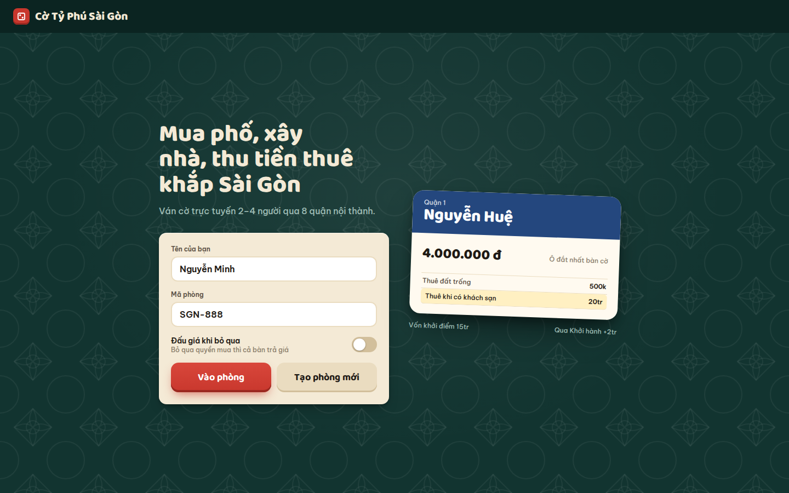 | 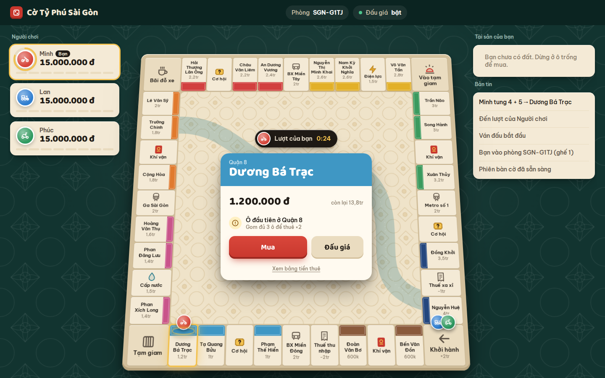 |
| **Đấu giá** | **Giữa ván** |
| 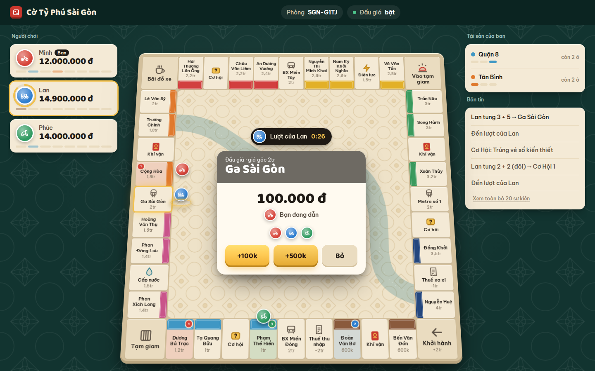 | 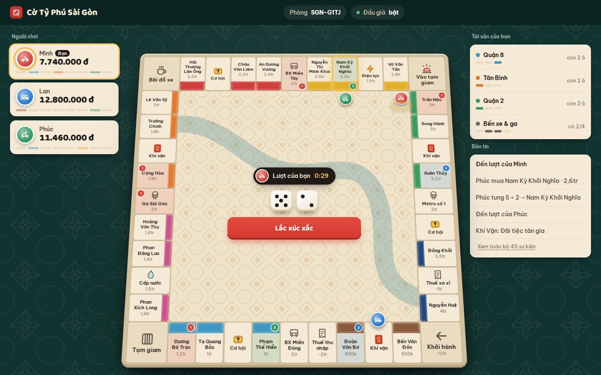 |
| **Tra cứu ô + bảng tiền thuê** | **Mobile (chưa tối ưu)** |
| 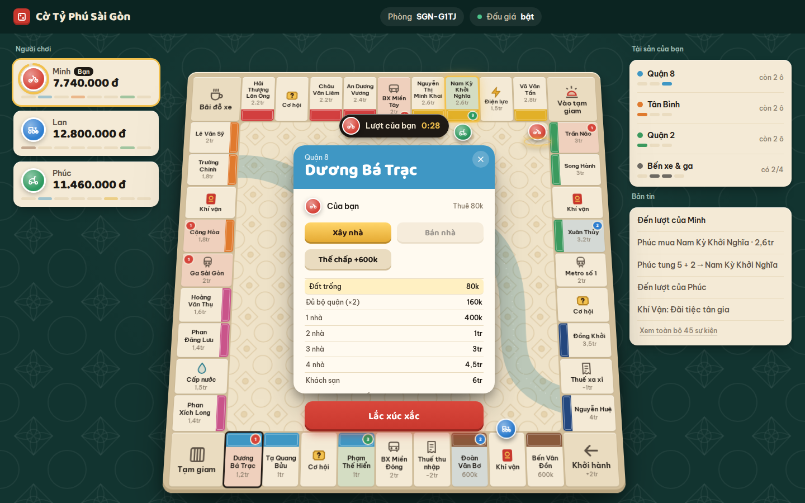 | 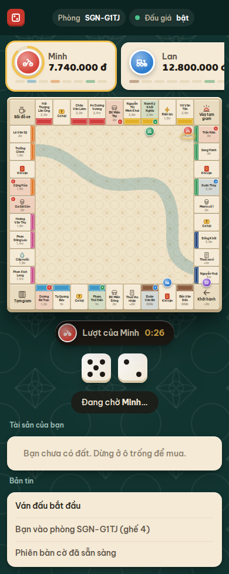 |

**Đã làm:**
- Bảng màu, họa tiết gạch bông, font Be Vietnam Pro + Baloo 2, thang 4 cỡ chữ (`index.html`).
- Bàn cờ chuyển từ SVG sang lưới HTML nghiêng 16°. Chữ co giãn theo bàn (`cqw`), ô có biển hiệu quận, tô màu chủ sở hữu, icon cho ô đặc biệt, tên ngắn (`board.rs`, `palette.rs`).
- Quân cờ là 4 loại xe, đứng ở mép trong ô. Node DOM được giữ cố định nên quân **trượt từng ô**, sửa lỗi "teleport" nêu trong review.
- Sân khấu giữa bàn (`stage.rs`): thanh lượt có đồng hồ, xúc xắc, vé số Cơ hội / phong bì Khí vận, thẻ mua đất (giá, tiền còn lại, một lý do, 2 nút), thẻ đấu giá (`+100k / +500k / Bỏ`), thẻ tra cứu ô (chủ, tiền thuê, xây/bán/thế chấp nếu là của mình), bảng tiền thuê ẩn sau link, "Đang chờ Lan…".
- Cột trái (`players.rs`): avatar xe, vòng đếm giờ, tiền, vạch quận, trạng thái tạm giam / mất kết nối.
- Cột phải (`portfolio.rs`, `log.rs`): tài sản theo quận có nút "Xây nhà" (tự chọn ô theo luật xây đều); bản tin một dòng mỗi sự kiện, dùng tên đường, bỏ dòng trùng.
- Sảnh: form gọn, công tắc đấu giá thật, thẻ mẫu lấy từ dữ liệu thật (đã sửa lỗi sai giá/ô).
- `controls.rs` đã được thay bằng `stage.rs`.

**Chưa làm:**
- Mobile camera bám quân và minimap (giai đoạn 3). Hiện mobile chỉ xếp dọc, bàn cờ còn nhỏ.
- Phòng chờ, màn kết thúc ván, giao dịch, màn thiếu tiền. Các phần này cần sửa server.
- Âm thanh.
- Các lỗi server trong `docs/review/REVIEW.md`, gồm lỗi treo phòng khi người đang tới lượt đóng tab.
